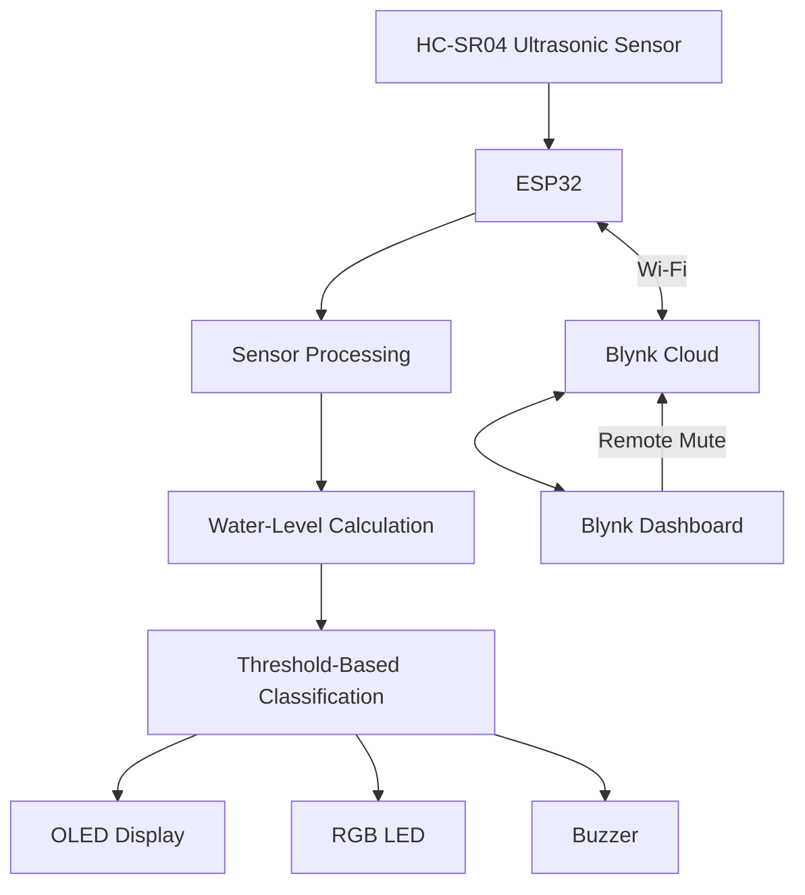

# SumpSense
### IoT-Based Smart Sump Water-Level Monitoring and Early-Warning System

An ESP32-based embedded IoT system that monitors sump water levels using ultrasonic sensing, provides real-time alerts, and enables remote monitoring through Blynk Cloud.

## Overview

SumpSense automates sump water-level monitoring by combining ultrasonic sensing, embedded processing, local indicators, and cloud connectivity.

The ESP32 processes sensor readings to identify water-level conditions and activates appropriate visual and audible alerts. Blynk IoT integration enables remote monitoring and buzzer control over Wi-Fi.

## Key Features

- Real-time water-level measurement using an HC-SR04 ultrasonic sensor.
- Threshold-based classification of low, normal, and high water levels.
- OLED-based display of distance, water-level percentage, and system status.
- RGB LED and buzzer for local alerts.
- Blynk IoT integration for remote monitoring and buzzer control.
- Median filtering to improve the reliability of sensor readings.

## System Architecture

## Wokwi Simulation

The SumpSense circuit is also available as a Wokwi simulation for exploring the hardware connections and simulated implementation.

🔗 **[View SumpSense Simulation on Wokwi](https://wokwi.com/projects/479213498247095297)**

## Hardware Components

| Component | Function |
|---|---|
| ESP32 DevKit V1 | Main controller |
| HC-SR04 | Ultrasonic distance measurement |
| SH1106 OLED | Real-time data display |
| RGB LED | Water-level indication |
| Active Buzzer | Audible alerts |
| Push Button | Physical mute input |

## Technologies Used

- **Programming:** Embedded C/C++
- **Microcontroller:** ESP32
- **Development Environment:** Arduino IDE
- **Communication:** Wi-Fi
- **IoT Platform:** Blynk Cloud
- **Display Library:** U8g2

## Circuit Connections

| Component | ESP32 GPIO |
|---|---:|
| OLED SDA | GPIO 13 |
| OLED SCL | GPIO 26 |
| Ultrasonic TRIG | GPIO 27 |
| Ultrasonic ECHO | GPIO 34 |
| RGB Red | GPIO 25 |
| RGB Green | GPIO 33 |
| RGB Blue | GPIO 32 |
| Buzzer | GPIO 14 |
| Push Button | GPIO 35 |

## Working Principle

1. The HC-SR04 sensor measures the distance between the sensor and the water surface.
2. The ESP32 processes the readings and calculates the water depth.
3. The calculated depth is compared against predefined thresholds.
4. The OLED displays the measurements and current status.
5. The RGB LED and buzzer indicate low and high water conditions.
6. Sensor data is transmitted to Blynk Cloud over Wi-Fi for remote monitoring and control.

## Water-Level Detection

The system uses the following configured parameters:

| Parameter | Value |
|---|---:|
| Sensor-to-bottom distance | 21 cm |
| Container height | 18 cm |
| Low water threshold | 4 cm |
| High water threshold | 14 cm |

**Water depth = Sensor-to-bottom distance − Measured distance**

| Water Depth | Status | LED |
|---|---|---|
| Below 4 cm | Low | Blue |
| 4–14 cm | Normal | Green |
| Above 14 cm | High | Red |

## IoT Integration – Blynk

Blynk Cloud enables remote access to the system through a dashboard.

The ESP32 sends:
- Distance measurements
- Water-level percentage
- Current water status
- Alarm status

The dashboard also supports remote buzzer mute control. Blynk event notifications are configured for low-water and high-water conditions.

## Sensor Data Processing

The implementation uses a median-filtering approach to improve measurement reliability:

- Collects five ultrasonic readings per measurement cycle.
- Rejects invalid measurements.
- Requires at least three valid readings.
- Uses the median of valid readings for further processing.

## Project Demonstration

*Hardware photographs and demonstration video will be added.*

- Complete prototype
- OLED display readings
- Water-level LED indications
- Blynk IoT dashboard

## Known Limitations

- The physical push-button mute may occasionally require multiple attempts to register; Blynk remote mute is the current workaround.
- Remote monitoring and control require Wi-Fi connectivity.
- The system requires a continuous power supply.

## Future Improvements

- Optimise physical button polling and debouncing.
- Integrate backup power support.
- Add historical water-level monitoring and visualisation.
- Enhance remote notification capabilities.

